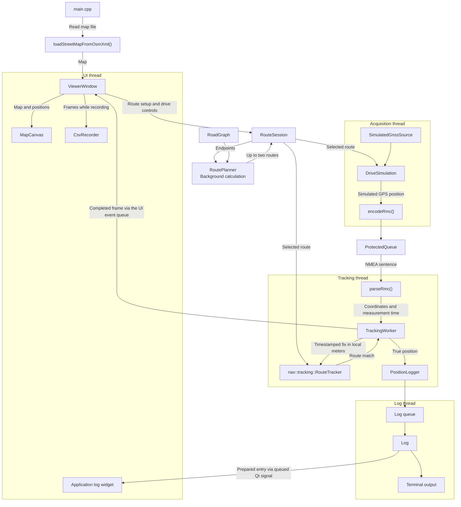

# NavNative

NavNative simulates GPS-based route following on a small street map of Barcelona. The viewer shows the simulated vehicle, its noisy GPS reading, and the position estimated by the tracker. It reports progress and off-route status and can record a drive to CSV.

## Build

Use CMake 3.21 or later and a compiler with C++20 support. The viewer requires Qt Widgets 6.5 or later. Choose a Qt kit that matches the compiler and architecture.

CMake uses a local pugixml package for map parsing and a local GoogleTest package for tests when available. Otherwise, it downloads the pinned source releases at configure time.

Run the commands from the project root. To select a Qt installation explicitly, pass `-DQt6_DIR="<directory containing Qt6Config.cmake>"` to the configure command. On Windows, put the matching Qt kit's `bin` directory before other Qt installations on `PATH`.

```sh
cmake -S . -B build -DCMAKE_BUILD_TYPE=Release
cmake --build build --config Release
ctest --test-dir build -C Release --output-on-failure
```

Run `NAVViewer` (`NAVViewer.exe` on Windows) from `build/` or `build/Release/`, depending on the CMake generator.

To build the navigation libraries and tests without Qt, add `-DNAV_BUILD_GUI=OFF` to the configure command. To omit the tests, configure with `-DBUILD_TESTING=OFF` and skip the `ctest` command.

## Run a simulation

The viewer opens on a map of the Eixample district. Select **Set Start / Destination**, then click two points on the map. The clicks snap to street nodes. Before starting a drive, right-click the map to clear both endpoints and the route choices. The planner returns the two shortest distinct routes by distance when both exist. Select a route by clicking its line or using the dropdown, then press **Start**. The viewer's **Help** button explains these controls.

Arrows show the allowed direction on one-way streets. During a drive, green marks the simulated vehicle, yellow marks the GPS reading, and blue marks the matched position. Adjust speed and GPS noise with the sliders. **Pause** preserves the current drive and queued messages. **Stop** ends the drive and clears the queue. **Reset** stops an active drive and clears the route and GPS trail so you can select new endpoints.

**Record CSV** writes elapsed recording time, vehicle and GPS positions, the matched position, true and estimated progress, distance from the route, and the off-route flag. **Stop Recording** closes the file.

The application log below the drive status shows information, warnings, and errors. A dedicated log thread writes every completed frame's true position to the terminal. The on-screen log receives the first true-position entry of each drive and then at most one every three seconds. The log thread prepares those entries and delivers them through a queued Qt signal. The UI thread inserts them into the widget.

CMake copies `Eixample.osm` beside the executable. At startup, the offline importer reads the streets and building footprints and converts their coordinates to local meters. Map data © OpenStreetMap contributors, available under the Open Database License. [Attribution and license](https://www.openstreetmap.org/copyright)

## Architecture



The session owns route setup and the drive lifecycle. The planner uses A* and Yen's second-path search on the directed street graph. The selected route is shared by the simulator, tracker, and canvas. An acquisition thread generates simulated NMEA RMC sentences at a nominal interval of 100 ms. A tracking thread dequeues, validates, projects, and matches each fix. On resume, the tracking thread processes the preserved queue before acquisition restarts. On stop, the session discards pending messages and joins both workers.

| CMake target | Responsibility |
| --- | --- |
| `NAVCore` | Navigation library with geometry, routing, GNSS, tracking, simulation, session, and logging modules |
| `NAVViewer` | Qt controls and map rendering |
| `NAVTests` | GoogleTest executable |

## Project layout

```text
app/             Qt viewer
app/assets/      OpenStreetMap extract
include/nav/     Library headers organized by module
src/             Library implementations organized by module
tests/           GoogleTest cases
```

## TODO

- [ ] **Implement waypoint bearings.** Compute the direction from the matched position to a point ahead on the route, measured clockwise from north, and show it in the map viewer.
- [ ] **Implement dead reckoning.** Estimate position during short GNSS gaps using the last valid fix, speed, and course. Mark estimates in the viewer and compare them with simulator ground truth.
- [ ] **Verify cross-platform builds.** Build and run the Qt-free navigation libraries and tests on Windows and Linux using CMake. Build and smoke-test the Qt viewer on both platforms, including bundled map loading and CSV export. Document the dependencies and build commands for each platform.
- [ ] **Measure and improve route matching.** Estimate speed from recent matches and use it to predict progress. Rank candidates by GPS distance and deviation from predicted progress, weighted by their uncertainties. Compare progress error and wrong-segment rate against nearest-segment matching and the current continuity window on the same GPS trace.
- [ ] **Route around a traffic incident.** Decode an OpenLR line reference against the street graph, highlight the affected road, and compare routes using travel-time costs.
- [ ] **Simulate multiple cars.** Let the user choose how many cars to show and set each car's start, destination, and speed. Tag fixes with vehicle IDs and keep separate tracking state for each car.
