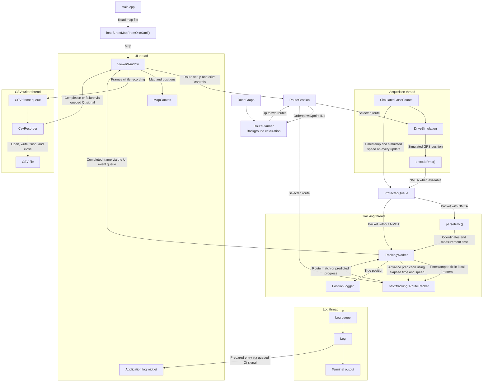

# NavNative

NavNative simulates GPS-based route following on a small street map of Barcelona. The viewer shows the simulated vehicle, its noisy GPS reading, and the position estimated by the tracker. It reports progress and off-route status and can record a drive to CSV.

## Build

Use CMake 3.21 or later and a compiler with C++20 support. The viewer requires Qt Widgets 6.5 or later. Choose a Qt kit that matches the compiler and architecture.

CMake uses a local pugixml package for map parsing and a local GoogleTest package for tests when available. Otherwise, it downloads the pinned source releases at configure time.

Run the commands from the project root. To select a Qt installation explicitly, pass `-DQt6_DIR="<directory containing Qt6Config.cmake>"` to the configure command. On Windows, put the matching Qt kit's `bin` directory before other Qt installations on `PATH`.

```sh
cmake -S . -B build -DCMAKE_BUILD_TYPE=Release
cmake --build build --config Release
ctest --test-dir build -C Release --output-on-failure
```

Run `NAVViewer` (`NAVViewer.exe` on Windows) from `build/` or `build/Release/`, depending on the CMake generator.

To build the navigation libraries and tests without Qt, add `-DNAV_BUILD_GUI=OFF` to the configure command. To omit the tests, configure with `-DBUILD_TESTING=OFF` and skip the `ctest` command.

## Run a simulation

The viewer opens on a map of the Eixample district. Select **Set Start / Destination**, then click at least two points in the order you want to visit them. The clicks snap to street nodes. Press **Enter** to plan a route through all the selected stops, from the first point to the last. Right-click the map while selecting stops or previewing routes to clear all markers and route choices. The planner offers the shortest route and an alternate when available. Select a route by clicking its line or using the dropdown, then press **Start**. The viewer's **Help** button explains these controls.

Arrows show the allowed direction on one-way streets. The checkboxes inside the map show or hide the green true-position marker, the yellow GPS marker and trail, and the blue route-match marker. All three are on by default. The red line between the GPS and matched positions is visible when both markers are shown.

Adjust speed and GPS noise with the sliders. **Pause** preserves the current drive and queued messages. **Stop** ends the drive and leaves the route visible. **Reset** clears the route, waypoints, and GPS trail so you can select new stops. Reaching the destination stops the drive and resets the map automatically.

Enable **Simulate dead reckoning** to introduce repeated GPS outages. The simulator waits a random 3–8 seconds between outages and picks a duration of 1–5 seconds. It shortens or skips an outage if there is too little distance left for GPS to return before arrival.

During an outage, the tracker starts at the last accepted GPS match and uses the speed slider as simulated wheel speed. It advances the estimate along the selected route on each update. The estimate is orange, and the stretch between the last match and the forward prediction turns orange as the prediction advances. When GPS matching resumes, the orange stretch clears and the estimate turns blue again.

**Record CSV** starts a background writer. The GUI queues frames with elapsed recording time, vehicle and GPS positions, the matched position, true and estimated progress, distance from the route, and the off-route flag. **Stop Recording** stops accepting frames and lets the writer finish queued rows before closing the file.

The `estimate_source` column identifies each row as `gps`, `predicted`, or `unavailable`. During an outage, the GPS coordinate fields are blank. If the tracker produces a prediction, the estimate fields contain its position and progress. The GPS-to-route distance and off-route fields are blank for predicted rows.

The application log below the drive status shows information, warnings, and errors. A dedicated log thread writes every completed frame's true position to the terminal. The on-screen log receives the first true-position entry of each drive and then at most one every three seconds. The log thread prepares those entries and delivers them through a queued Qt signal. The UI thread inserts them into the widget.

CMake copies `Eixample.osm` beside the executable. At startup, the offline importer reads the streets and building footprints and converts their coordinates to local meters. Map data © OpenStreetMap contributors, available under the Open Database License. [Attribution and license](https://www.openstreetmap.org/copyright)

## Architecture



The session owns route setup and the drive lifecycle. The planner uses A* and Yen's second-path search on the directed street graph for each leg between consecutive waypoints. The complete alternate uses the leg alternative that adds the least distance. The selected route is shared by the simulator, tracker, and canvas.

The acquisition thread publishes a timestamped packet at a nominal interval of 100 ms. During normal reception, the packet includes an NMEA RMC sentence, which the tracking thread decodes, projects, and matches to the route. During a simulated outage, the packet carries the update time and simulated speed without an NMEA sentence. The tracker uses that speed to advance its prediction for up to five seconds after the last accepted GPS match. On resume, the tracking thread processes the preserved queue before acquisition restarts. On stop, the session discards pending messages and joins both workers.

| CMake target | Responsibility |
| --- | --- |
| `NAVCore` | Navigation library with geometry, routing, GNSS, tracking, simulation, session, and logging modules |
| `NAVViewer` | Qt controls and map rendering |
| `NAVTests` | GoogleTest executable |

## Project layout

```text
app/             Qt viewer
app/assets/      OpenStreetMap extract
include/nav/     Library headers organized by module
src/             Library implementations organized by module
tests/           GoogleTest cases
```

## TODO

- [x] **Plan routes through intermediate waypoints.** Select stops in order, then press Enter to plan.
- [x] **Move CSV recording off the UI thread.** Write and close recordings on a background thread.
- [ ] **Add timestamps to logs and recordings.** Timestamp application log entries and preserve the original NMEA UTC measurement time in CSV.
- [ ] **Implement waypoint bearings.** Compute the direction from the matched position to a point ahead on the route, measured clockwise from north, and show it in the map viewer.
- [x] **Simulate route-constrained dead reckoning.** Use simulated wheel speed to predict progress during GPS outages. Show the predicted position and route stretch on the map and identify predicted rows in CSV.
- [ ] **Verify cross-platform builds.** Build and run the Qt-free navigation libraries and tests on Windows and Linux using CMake. Build and smoke-test the Qt viewer on both platforms, including bundled map loading and CSV export. Document the dependencies and build commands for each platform.
- [ ] **Measure and improve route matching.** Estimate speed from recent matches and use it to predict progress. Rank candidates by GPS distance and deviation from predicted progress, weighted by their uncertainties. Compare progress error and wrong-segment rate against nearest-segment matching and the current continuity window on the same GPS trace.
- [ ] **Route around a traffic incident.** Decode an OpenLR line reference against the street graph, highlight the affected road, and compare routes using travel-time costs.
- [ ] **Simulate multiple cars.** Let the user choose how many cars to show and set each car's start, destination, and speed. Tag fixes with vehicle IDs and keep separate tracking state for each car.
